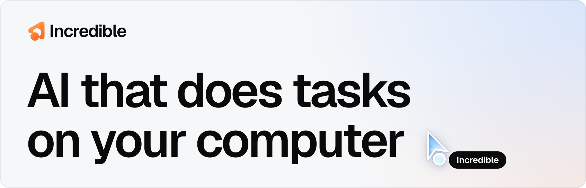
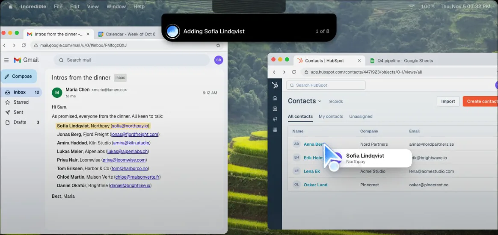

<a href="https://www.incredible.one">
  <picture>
    <source media="(prefers-color-scheme: dark)" srcset="https://raw.githubusercontent.com/incredible-one/.github/main/profile/assets/banner-dark.png">
    <source media="(prefers-color-scheme: light)" srcset="https://raw.githubusercontent.com/incredible-one/.github/main/profile/assets/banner-light.png">
    
  </picture>
</a>

Incredible is a desktop app for Mac and Windows. You hold a key and say what you need, or type it, and it clicks and types in your browser, your files and your apps the way you do, on your own computer.

An animated demo from our home page. [Screen recordings of each use case](https://www.incredible.one/usecases) are on the site.

## What it works in

- [Any website](https://www.incredible.one/learn/browser), in your own browser and signed in as you. That includes the CRMs, ERPs, supplier portals and admin panels that have no integration.
- [The files on your computer](https://www.incredible.one/learn/local-files), including Word, Excel, PowerPoint and PDF.
- [Connected apps](https://www.incredible.one/learn/app-connectors) such as Gmail, Slack, Google Calendar and Notion, and any tool that speaks [MCP](https://www.incredible.one/learn/mcp).

For long tasks that have to be done your way, [record yourself doing the task once](https://www.incredible.one/learn/teach) while you talk it through, and Incredible does it the same way from then on.

When you give Incredible a task, it asks before anything is sent, and you can approve the step, change it first, or stop. A task on [Autopilot](https://www.incredible.one/learn/autopilot) runs by itself when something happens in your apps, the way you set it up.

We are a Swedish AI startup, founded by Philip Alm and David Bacelj, with Emil Wagman as CTO.

## Open source

[STELLA](https://github.com/incredible-one/STELLA) is our earlier multi-agent framework, released under AGPL-3.0. The repository is archived and no longer maintained.

## Links

[Website](https://www.incredible.one) · [Download](https://www.incredible.one/start) · [Learn](https://www.incredible.one/learn) · [Careers](https://www.incredible.one/careers) · [X](https://x.com/useincredible) · [LinkedIn](https://www.linkedin.com/company/incredible-linkedin/) · [llms.txt](https://www.incredible.one/llms.txt)
